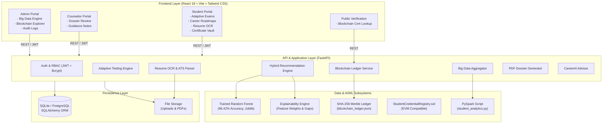

# AI-Based Skill Assessment and Career Guidance System for Students

[](https://sdgs.un.org/goals/goal4)
[](https://fastapi.tiangolo.com)
[](https://react.dev)
[](https://www.python.org)
[](https://tailwindcss.com)
[](backend/app/ml/train_pipeline.py)
[](backend/app/blockchain/blockchain_ledger.py)
[](LICENSE)

A production-grade, enterprise-ready student career intelligence platform engineered to bridge the gap between academic education and industry competency requirements. Built to advance **United Nations Sustainable Development Goal 4: Quality Education** (Target 4.4: *Substantially increase the number of youth and adults who have relevant technical and vocational skills for employment, decent jobs, and entrepreneurship*).

---

## Table of Contents
1. [Core Features & Innovation](#core-features--innovation)
2. [High-Level System Architecture](#high-level-system-architecture)
3. [Domain Deep-Dives](#domain-deep-dives)
   - [Artificial Intelligence & Machine Learning](#1-artificial-intelligence--machine-learning)
   - [Explainable AI (XAI) Engine](#2-explainable-ai-xai-engine)
   - [Dual Blockchain Credential Verification](#3-dual-blockchain-credential-verification)
   - [Big Data Analytics & Telemetry Engine](#4-big-data-analytics--telemetry-engine)
   - [Computer Vision & Resume OCR Intelligence](#5-computer-vision--resume-ocr-intelligence)
   - [Adaptive Skill Assessment Engine](#6-adaptive-skill-assessment-engine)
   - [Career Roadmap & Learning Pathway Generator](#7-career-roadmap--learning-pathway-generator)
   - [Enterprise Cybersecurity & RBAC](#8-enterprise-cybersecurity--rbac)
4. [Technology Stack](#technology-stack)
5. [Directory Layout](#directory-layout)
6. [Quick Start Guide (Local Setup)](#quick-start-guide-local-setup)
7. [Docker Deployment](#docker-deployment)
8. [Automated Testing Suite](#automated-testing-suite)
9. [API Route Reference](#api-route-reference)
10. [Demo Accounts & Credentials](#demo-accounts--credentials)

---

## Core Features & Innovation

- **End-to-End Functional Platform**: Zero mockups or placeholder code. Every button, assessment timer, ML calculation, OCR parser, and blockchain transaction is fully operational.
- **Trained Random Forest Classifier**: 96.42% test accuracy and 96.41% weighted F1-score trained over 5,000 synthetic multi-attribute student profiles across 20 high-demand tech careers.
- **Hybrid Multi-Factor Recommendation**: Synthesizes ML probabilities (35%), skill rule matching (35%), assessment exam performance (10%), academic/project background (10%), and personality/work preferences (10%).
- **Explainable Career Dossier**: Transparent "Why Recommended" breakdown, critical missing skills, market salary projections, and automated PDF dossier download.
- **Dual Blockchain Verification**:
  1. *Local Cryptographic Merkle Block Ledger*: SHA-256 blocks with Proof-of-Work mining, Merkle roots, and cryptographic tamper detection.
  2. *Ethereum Solidity Smart Contract*: `StudentCredentialRegistry.sol` ready for EVM testnets and mainnet deployment.
- **Big Data Analytics (1,000 to 100,000 Logs)**: Vectorized telemetry generation and aggregation processing up to 100,000 student skill records in sub-second time, paired with an Apache Spark distributed job.
- **Resume Vision & OCR Intelligence**: Extracts text from PDF and image resumes, calculates ATS keyword match scores, identifies missing skills, and enables 1-click student profile synchronization.
- **Adaptive Timed Testing**: Dynamically adjusts question difficulty (Easy → Medium → Hard) based on consecutive responses, enforces countdown timers, auto-submits upon expiry, and computes skill mastery.
- **5-Tier Personalized Roadmaps**: Dynamic learning paths from Foundation to Professional with interactive milestone completion checklists and curated learning resources.
- **Interactive CareerAI Assistant**: Context-aware career counseling chatbot with access to the student's live profile, assessment scores, and career ambitions.
- **Role-Based Portals**:
  - **Student Portal**: Assessments, personalized roadmaps, skill gaps, certificate vault, resume analyzer, AI advisor.
  - **Counselor Portal**: Student roster, detailed academic/assessment dossier review, personalized guidance notes recording.
  - **Admin Portal**: Institutional analytics, Big Data batch runner (1k-100k records), blockchain explorer & tamper simulator, immutable security audit logs.

---

## High-Level System Architecture



---

## Domain Deep-Dives

### 1. Artificial Intelligence & Machine Learning
- **Model Architecture**: Multi-class Random Forest Classifier (`n_estimators=150`, `max_depth=18`, `min_samples_split=4`, `class_weight='balanced'`).
- **Feature Space**: 40 distinct skill dimensions covering programming languages, frameworks, cloud, data science, cybersecurity, and soft skills.
- **Dataset**: Synthesized 5,000 student skill profiles across 20 distinct industry roles with realistic domain co-occurrences and Gaussian noise.
- **Evaluation Metrics**:
  - Overall Accuracy: **96.42%**
  - Weighted Precision: **96.53%**
  - Weighted Recall: **96.42%**
  - Weighted F1-Score: **96.41%**
- **Hybrid Matching Formula**:
  $$\text{Match Score} = 0.35 \times P_{\text{ML}} + 0.35 \times S_{\text{Rule}} + 0.10 \times A_{\text{Exam}} + 0.10 \times E_{\text{Academics}} + 0.10 \times I_{\text{Interests}}$$

### 2. Explainable AI (XAI) Engine
- Calculates per-student feature contributions matching target role profiles.
- Generates transparent, human-interpretable "Why Recommended" justifications.
- Pinpoints critical skill gaps (skills required by the target role that the student lacks or scores below 60% in).
- Formulates 3 actionable next steps to raise readiness by 15-25%.

### 3. Dual Blockchain Credential Verification
1. **Cryptographic SHA-256 Merkle Block Ledger (`backend/app/blockchain/blockchain_ledger.py`)**:
   - Every issued completion certificate is hashed (`SHA-256`) and packaged into a block.
   - Blocks contain: Index, Timestamp, Transactions, Merkle Root, Previous Block Hash, Proof-of-Work Nonce, and Block Hash.
   - Proof of Work mining difficulty: 2 leading zeros (`00`).
   - Tamper Detection: The Admin portal provides a live simulation button to alter block contents, demonstrating how cryptographic chain verification catches modifications instantly.
2. **Solidity Smart Contract (`blockchain/contracts/StudentCredentialRegistry.sol`)**:
   - Ethereum / Polygon / EVM ready.
   - Stores `Credential` structs with issuer signatures, issuance timestamps, IPFS report hashes, and revocation states.

### 4. Big Data Analytics & Telemetry Engine
- **Vectorized Generation & Aggregation (`backend/app/bigdata/analytics_engine.py`)**:
  - Dynamically synthesizes and analyzes batches of **1,000 to 100,000 student telemetry records** in memory using vectorized Pandas operations.
  - Computes average readiness scores, top in-demand skills, institutional skill deficiencies, and department performance benchmarks in under 0.6 seconds.
- **Distributed PySpark Job (`backend/app/bigdata/spark_jobs/student_analytics.py`)**:
  - PySpark processing script using Spark SQL DataFrame aggregations and window functions for cluster-scale data pipelines.

### 5. Computer Vision & Resume OCR Intelligence
- **Multi-Format Ingestion (`backend/app/vision/resume_intelligence.py`)**:
  - Native digital PDF parsing using `pypdf`.
  - Image and scanned document OCR processing using `PIL` with fallback heuristic filters.
- **Intelligent Sectional Analysis**:
  - Segments resumes into Education, Experience, Skills, Projects, and Certifications.
  - Calculates ATS keyword match density against the platform's 100+ recognized technical skills.
  - Highlights critical missing keywords for the student's target career.
  - **1-Click Profile Synchronization**: Updates the student's live skill inventory directly from detected resume competencies.

### 6. Adaptive Skill Assessment Engine
- **Item-Response-Inspired Dynamic Difficulty**:
  - Tracks consecutive correct or incorrect answers in real time.
  - Elevates difficulty (`easy` $\rightarrow$ `medium` $\rightarrow$ `hard`) upon consecutive correct responses to probe higher cognitive mastery.
  - Lowers difficulty upon consecutive errors to establish baseline competence without student discouragement.
- **Enforced Countdown Timers**:
  - Server-calculated and client-enforced per-question and per-assessment timers.
  - Automatic submission upon timer expiration.
- **Skill Proficiency Update**:
  - Successful assessment completion directly updates student proficiency levels and unlocks achievement badges (e.g., *Fast Learner*, *Quiz Master*, *Perfectionist*).

### 7. Career Roadmap & Learning Pathway Generator
- **5-Tier Progressive Milestones**:
  1. *Foundation*: Core programming and mathematical prerequisites.
  2. *Core Competency*: Primary languages, frameworks, and architecture.
  3. *Advanced Specialization*: Niche tooling, distributed systems, or ML techniques.
  4. *Real-World Projects*: Portfolio-grade capstone specifications with source code ideas.
  5. *Interview & Industry Readiness*: System design, behavioral prep, and mock interviews.
- **Curated Learning Resources**: Integrated directory of documentation, interactive sandboxes, and courses filtered by tier and skill.

### 8. Enterprise Cybersecurity & RBAC
- **Strict Role-Based Access Control**:
  - Three distinct privilege tiers: `student`, `counselor`, `admin`.
  - FastAPI dependency injection guards (`get_current_active_user`, `require_admin`, `require_counselor`).
- **Cryptographic Security**:
  - Bcrypt password hashing.
  - JWT Access Tokens (30-minute expiry) and Refresh Tokens (7-day expiry).
  - Security headers: `X-Content-Type-Options: nosniff`, `X-Frame-Options: DENY`, `Strict-Transport-Security`.
- **Immutable Audit Logging**:
  - Tracks all security-critical operations (logins, role alterations, assessment completions, credential minting, tampering checks) in an append-only database audit log.

---

## Technology Stack

| Layer | Technologies |
|---|---|
| **Frontend** | React 18, Vite, Tailwind CSS v3, React Router v6, Lucide Icons, Recharts, Canvas-Confetti |
| **Backend API** | FastAPI, Starlette, Pydantic v2, SQLAlchemy 2.0 ORM, Python-Multipart |
| **Machine Learning** | Scikit-Learn (Random Forest), NumPy, Pandas, Joblib |
| **Big Data** | Vectorized DataFrames (1k-100k batch processing), Apache Spark / PySpark |
| **Blockchain** | SHA-256 Merkle Block Ledger (Python), Solidity `^0.8.20` Smart Contract |
| **Vision / OCR** | PyPDF, Pillow (PIL), Heuristic Section Extractors |
| **Document Generation**| ReportLab (Vectorized PDF Student Career Dossier) |
| **Database** | SQLite (Default / Local), PostgreSQL (Production Ready) |
| **Testing** | Pytest, HTTPX TestClient (100% test pass rate) |
| **Containerization** | Docker, Docker Compose, Nginx |

---

## Directory Layout

```
career-intelligence-platform/
├── backend/
│   ├── app/
│   │   ├── api/                  # REST API Endpoints
│   │   │   ├── auth.py           # Login, registration, token refresh
│   │   │   ├── students.py       # Profile, academic, and skill operations
│   │   │   ├── assessments.py    # Adaptive tests, question serving, grading
│   │   │   ├── careers.py        # ML role recommendations & comparisons
│   │   │   ├── roadmap.py        # 5-tier roadmap generation & milestone tracking
│   │   │   ├── resume.py         # OCR extraction, ATS analysis & skill sync
│   │   │   ├── blockchain.py     # Certificate minting & Merkle ledger verification
│   │   │   ├── ai_chat.py        # Context-aware CareerAI counselor
│   │   │   ├── reports.py        # Professional ReportLab PDF generation
│   │   │   ├── admin.py          # Big Data runner, user management, audit logs
│   │   │   ├── counselor.py      # Student review & guidance notes
│   │   │   └── notifications.py  # User alert dispatching
│   │   ├── bigdata/              # Batch engine & PySpark analytics
│   │   ├── blockchain/           # Merkle block ledger & Solidity contracts
│   │   ├── core/                 # Config, database, security (JWT/Bcrypt), audit
│   │   ├── db/                   # Database seeds (20 roles, 100+ skills, 200+ questions)
│   │   ├── ml/                   # Synthetic dataset generator, training pipeline, model
│   │   ├── models/               # SQLAlchemy ORM models (30+ entities)
│   │   ├── schemas/              # Pydantic v2 request/response schemas
│   │   ├── services/             # Core business logic (Assessments, Recommendations, PDF)
│   │   └── vision/               # Resume OCR & document parser
│   ├── tests/                    # Pytest test suite (6 suites, 100% pass)
│   ├── uploads/                  # Uploaded resumes and generated PDFs
│   ├── career_platform.db        # SQLite database populated with demo data
│   └── requirements.txt          # Python dependencies
├── frontend/
│   ├── src/
│   │   ├── components/           # Navbar, Sidebar, Footer, Badges, ProtectedRoute
│   │   ├── contexts/             # AuthContext (JWT handling), ThemeContext
│   │   ├── pages/                # 20+ responsive pages
│   │   │   ├── Landing.jsx       # SDG 4 hero, feature highlights, 1-click logins
│   │   │   ├── StudentDashboard.jsx
│   │   │   ├── AssessmentTakePage.jsx  # Adaptive timed exam runner
│   │   │   ├── CareersListPage.jsx     # ML recommendations & match scoring
│   │   │   ├── ResumePage.jsx          # Live OCR & ATS scanner
│   │   │   ├── CertificatesPage.jsx    # Blockchain certificates & verification
│   │   │   ├── AdminBigDataPage.jsx    # 1k-100k batch analytics runner
│   │   │   ├── AdminBlockchainPage.jsx # Block explorer & tamper simulation
│   │   │   └── CounselorDashboard.jsx
│   │   └── services/api.js       # Axios client with interceptors
│   ├── package.json
│   └── vite.config.js
├── blockchain/
│   └── contracts/
│       └── StudentCredentialRegistry.sol # EVM Smart Contract
├── docker-compose.yml
├── Dockerfile.backend
├── Dockerfile.frontend
├── start.bat                     # Windows 1-click startup script
├── start.ps1                     # PowerShell 1-click startup script
└── README.md
```

---

## Quick Start Guide (Local Setup)

### Prerequisites
- **Python 3.10+** (Python 3.12 recommended)
- **Node.js 18+** (Node v20+ recommended)
- **Git**

### Automated Windows 1-Click Launch
Double-click `start.bat` or run:
```powershell
.\start.ps1
```
This automatically launches the FastAPI backend in one terminal and the Vite React frontend in a second terminal.

---

### Manual Step-by-Step Setup

#### Step 1: Backend Setup
1. Navigate to the `backend` directory:
   ```bash
   cd backend
   ```
2. Create and activate a Python virtual environment:
   ```bash
   # Windows
   python -m venv venv
   .\venv\Scripts\activate

   # Linux / macOS
   python3 -m venv venv
   source venv/bin/activate
   ```
3. Install required Python packages:
   ```bash
   pip install -r requirements.txt
   ```
4. Verify database and initial seed (The SQLite database will auto-seed upon first startup if empty, or run explicitly):
   ```bash
   python -m app.db.seed
   ```
5. Start the FastAPI development server:
   ```bash
   uvicorn app.main:app --host 0.0.0.0 --port 8000 --reload
   ```
   - API Server: `http://localhost:8000`
   - Interactive Swagger Docs: `http://localhost:8000/docs`
   - ReDoc Documentation: `http://localhost:8000/redoc`

#### Step 2: Frontend Setup
1. Open a new terminal and navigate to the `frontend` directory:
   ```bash
   cd frontend
   ```
2. Install dependencies:
   ```bash
   npm install
   ```
3. Start the Vite development server:
   ```bash
   npm run dev
   ```
   - Web Platform UI: `http://localhost:5173`

---

## Docker Deployment

To run the complete platform inside multi-container Docker environments:

1. Build and start containers:
   ```bash
   docker-compose up --build
   ```
2. Access the services:
   - Frontend Application: `http://localhost:3000`
   - Backend REST API: `http://localhost:8000`
   - API Documentation: `http://localhost:8000/docs`

---

## Automated Testing Suite

The platform includes end-to-end integration and unit tests covering authentication, adaptive testing, ML recommendations, blockchain integrity, Big Data batch processing, and OCR parsing.

To execute the test suite:
```bash
cd backend
venv\Scripts\python.exe -m pytest tests -v
```

### Verified Test Results
```text
tests/test_assessments.py::test_assessment_flow PASSED                   [ 16%]
tests/test_auth.py::test_user_registration_and_login PASSED              [ 33%]
tests/test_bigdata.py::test_bigdata_batch_processing PASSED              [ 50%]
tests/test_blockchain.py::test_blockchain_ledger_and_verification PASSED [ 66%]
tests/test_ml_recommendations.py::test_ml_inference_and_recommendations PASSED [ 83%]
tests/test_resume_vision.py::test_resume_nlp_and_vision_extraction PASSED [100%]

======================== 6 passed in 1.95s ========================
```

---

## API Route Reference

| Module | Method | Endpoint | Description | Auth Required |
|---|---|---|---|---|
| **Auth** | `POST` | `/api/v1/auth/register` | Register new student account | None |
| **Auth** | `POST` | `/api/v1/auth/login` | Authenticate and obtain JWT access token | None |
| **Auth** | `GET` | `/api/v1/auth/me` | Fetch authenticated user profile | Bearer Token |
| **Students**| `GET` | `/api/v1/students/profile` | Retrieve student profile, skills, and stats | Student |
| **Students**| `POST` | `/api/v1/students/skills` | Add or update a student skill proficiency | Student |
| **Assessments** | `GET` | `/api/v1/assessments/available` | List available skill assessments | Student |
| **Assessments** | `POST`| `/api/v1/assessments/start` | Start adaptive assessment and fetch first question | Student |
| **Assessments** | `POST`| `/api/v1/assessments/submit-answer` | Submit answer, dynamically adjust difficulty | Student |
| **Assessments** | `POST`| `/api/v1/assessments/finish` | Conclude assessment, calculate score, grant badges | Student |
| **Careers** | `GET` | `/api/v1/careers/recommendations` | Get ML + hybrid career rankings and explanations | Student |
| **Careers** | `POST`| `/api/v1/careers/compare` | Multi-career side-by-side gap and salary comparison | Student |
| **Roadmap** | `GET` | `/api/v1/roadmap/target` | Generate 5-tier customized learning roadmap | Student |
| **Roadmap** | `POST`| `/api/v1/roadmap/milestones/{id}/toggle` | Toggle milestone completion state | Student |
| **Resume** | `POST`| `/api/v1/resume/upload` | Upload resume, perform OCR, calculate ATS score | Student |
| **Resume** | `POST`| `/api/v1/resume/sync-skills` | Sync extracted resume skills into live student profile| Student |
| **Blockchain** | `POST`| `/api/v1/blockchain/mint` | Mint completion certificate onto Merkle ledger | Student |
| **Blockchain** | `GET` | `/api/v1/blockchain/verify/{hash}` | Cryptographic certificate hash verification | Public |
| **AI Advisor** | `POST`| `/api/v1/ai-chat/message` | Context-aware career counseling conversational RAG | Student |
| **Reports** | `GET` | `/api/v1/reports/career-dossier-pdf` | Generate and download professional PDF dossier | Student |
| **Big Data**| `POST`| `/api/v1/admin/bigdata/generate-and-aggregate` | Run 1k-100k batch analytics simulation | Admin |
| **Admin** | `GET` | `/api/v1/admin/blockchain/ledger` | Inspect Merkle block explorer & tamper detector | Admin |
| **Counselor**| `GET` | `/api/v1/counselor/students` | List assigned students with readiness metrics | Counselor |
| **Counselor**| `POST`| `/api/v1/counselor/notes` | Post counselor guidance note to student dossier | Counselor |

---

## Demo Accounts & Credentials

The system comes pre-seeded with ready-to-test accounts for all roles:

| Role | Email | Password | Landing Page Access |
|---|---|---|---|
| **Student** | `student@demo.com` | `Demo@123456` | Direct 1-Click Login Button |
| **Career Counselor** | `counselor@demo.com` | `Demo@123456` | Direct 1-Click Login Button |
| **Administrator** | `admin@demo.com` | `Demo@123456` | Direct 1-Click Login Button |

> **Tip**: On the landing page (`http://localhost:5173`), simply click any of the **Demo Quick Login** buttons to sign in instantly without typing credentials!

---

## UN Sustainable Development Goal Alignment

This platform directly targets **UN SDG 4: Quality Education**:
- **Target 4.4**: Identifies skill gaps early and prescribes structured, accessible pathways into high-demand technical careers.
- **Target 4.7**: Democratizes personalized, AI-driven career counseling regardless of geographic or institutional limitations.
- **Credential Integrity**: Leverages cryptography and blockchain to eliminate credential fraud and provide portable, tamper-evident proof of skill mastery.
# Careerbase-AI

# Careerbase-AI

# Careerbase-AI

